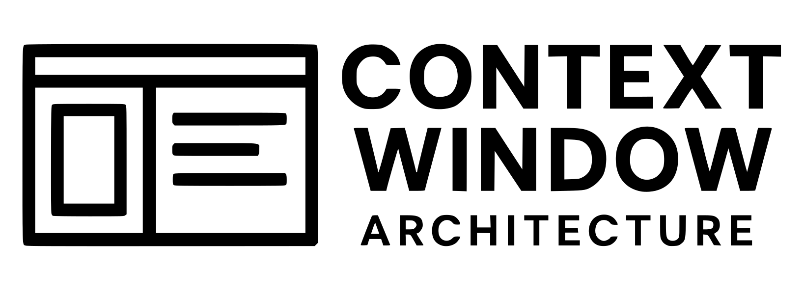
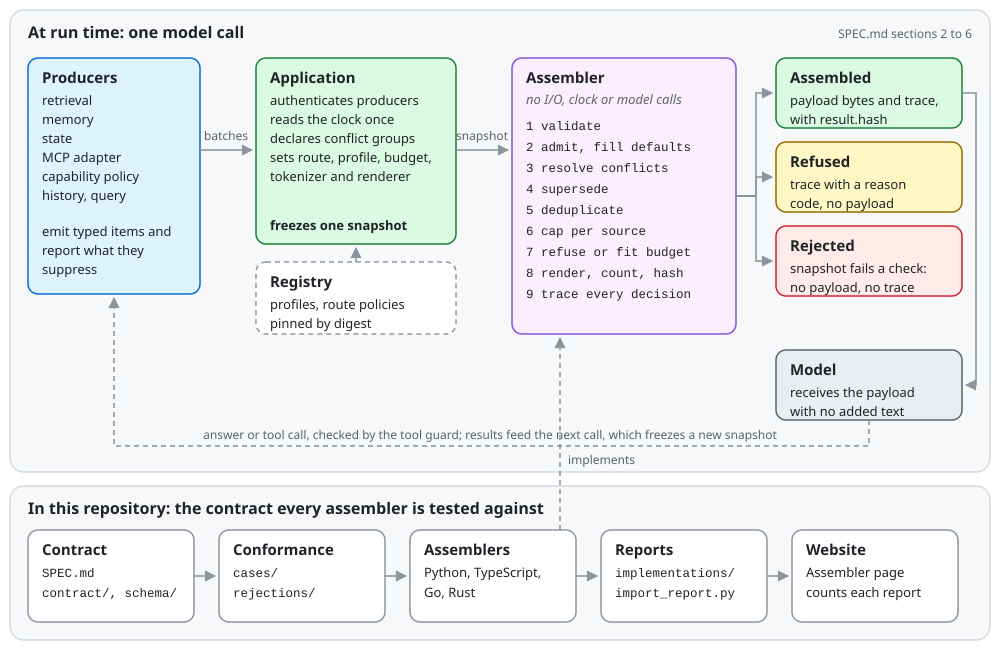

<p align="center">
  <picture>
    <source media="(prefers-color-scheme: dark)" srcset="assets/images/logo-horizontal-dark.png">
    
  </picture>
</p>

<p align="center">
  <a href="https://github.com/contextwindowarchitecture/contextwindowarchitecture/actions/workflows/ci.yml"></a>
  <a href="SPEC.md"></a>
  <a href="LICENSE"></a>
</p>

Context Window Architecture (CWA) is a draft specification for assembling every model call from typed slots, for people who build the producers, assemblers and applications that feed a model.

This repository holds the specification itself: its [text](SPEC.md), its [JSON Schemas](schema), its [contract data](contract), its [conformance cases](conformance) and its [examples](examples). [contextwindowarchitecture.io](https://contextwindowarchitecture.io) presents the same specification with guides, the evidence behind it, browser tools, and each implementation's conformance report.

## Contents

- [How it fits together](#how-it-fits-together)
- [Quickstart](#quickstart)
- [Install](#install)
- [Determinism and idempotency](#determinism-and-idempotency)
- [Where to start](#where-to-start)
- [Repository layout](#repository-layout)
- [Implementations](#implementations)
- [Contributing](#contributing)
- [How this repository is maintained](#how-this-repository-is-maintained)
- [License](#license)

## How it fits together

<p align="center">
  <picture>
    <source media="(prefers-color-scheme: dark)" srcset="assets/images/wiring-dark.svg">
    
  </picture>
</p>

The diagram's Mermaid source is [assets/images/wiring.mmd](assets/images/wiring.mmd).

1. **[Producers](guides/producers.md)** (a retriever, a memory store, a state service, an [MCP adapter](guides/mcp.md), the capability policy) emit candidate **[items](SPEC.md#22-item-fields)** in **[producer batches](schema/producer_batch.schema.json)**. Each item names one of eleven **[slots](SPEC.md#21-slots)**, grouped into four **[planes](SPEC.md#2-model-planes-slots-items)**.
2. **The application** [authenticates each producer](SPEC.md#r-15-authenticated-capability-admission-mcp-output-is-evidence), reads the clock once, and freezes the batches, a **[route policy](schema/route_policy.schema.json)**, a **[placement profile](SPEC.md#5-placement-profiles)**, a budget, a tokenizer and a renderer into one **[snapshot](schema/snapshot.schema.json)**.
3. **An [assembler](guides/assemblers.md)** runs the [pipeline](guides/assemblers.md#the-pipeline) over the snapshot without I/O or model calls ([R-18](SPEC.md#r-18-precomputed-variants-no-model-calls-during-assembly)). It ends in one of three outcomes:
   - **Assembled:** the **payload** bytes to send and a **[trace](schema/trace.schema.json)** of every decision.
   - **Refused:** a trace with a [reason code](contract/reasons.json) and no payload ([R-17](SPEC.md#r-17-refused-assembly-has-no-rendered-payload)).
   - **Rejected:** the snapshot breaks a [snapshot check](conformance/README.md#snapshot-checks), so there is no payload and no trace.
4. **The application** hands the payload to the model in the roles the renderer assigns and adds no text ([SPEC.md §1](SPEC.md#1-conformance)). Tool results become evidence for the next call, which freezes a new snapshot.

The [harness guide](guides/harness.md) shows where these steps sit inside an agent loop.

## Quickstart

This runs the Python reference assembler over the example snapshot in this repository and checks the result against the committed payload.

**Prerequisites:** [git](https://git-scm.com), [uv](https://docs.astral.sh/uv/getting-started/installation/), and Python 3.11 or newer (`uv python install` provides one).

**1. Clone the specification.**

```sh
git clone https://github.com/contextwindowarchitecture/contextwindowarchitecture.git
cd contextwindowarchitecture
```

**2. Assemble [examples/messages-snapshot.json](examples/messages-snapshot.json) twice.** uv installs the assembler from its `draft-release` tag into a temporary environment.

```sh
CWA_PY="contextwindowarchitecture-assembler @ git+https://github.com/contextwindowarchitecture/assembler-python@draft-release"
uv run --no-project --with "$CWA_PY" python - <<'EOF'
import json, pathlib
from cwa import Snapshot, assemble

snapshot = Snapshot.from_json(json.load(open("examples/messages-snapshot.json")))
first, second = assemble(snapshot), assemble(snapshot)

print("refused:", first.refused)
print("snapshot digest:", snapshot.digest())
print("payload hash:", first.trace["result"]["hash"])
print("same bytes on a second run:", first.payload == second.payload)
print("matches examples/messages-payload.json:", first.payload == pathlib.Path("examples/messages-payload.json").read_bytes())
EOF
```

Expected output:

```text
refused: False
snapshot digest: c4efedf3742c29e801a4acd552d5fc70aee75d69dd1487449a97e46a07f865c6
payload hash: b8e42c7b290b25bc8461ba76b85ba68b808a33c2d4684c7c3d82fe80b9ffde09
same bytes on a second run: True
matches examples/messages-payload.json: True
```

The snapshot digest equals `context.snapshot_digest` in [examples/messages-trace.json](examples/messages-trace.json). The payload hash is the SHA-256 of the payload bytes ([R-21](SPEC.md#r-21-trace-json-matches-the-published-schema)). If the digests differ after the specification changes, the example and the assembler's `draft-release` are at different commits.

**3. Make it refuse.** In the same shell, shrink the budget below what the protected instructions and query need.

```sh
uv run --no-project --with "$CWA_PY" python - <<'EOF'
import json
from cwa import Snapshot, assemble

document = json.load(open("examples/messages-snapshot.json"))
document["budget"]["input"] = 40  # too small for the protected instructions and query
result = assemble(Snapshot.from_json(document))

print("refused:", result.refused)
print("reason:", result.trace["refused"]["reason"])
print("payload:", result.payload)
EOF
```

Expected output:

```text
refused: True
reason: protected_content_over_budget
payload: None
```

The assembler refuses rather than truncate protected content ([R-16](SPEC.md#r-16-account-for-rendered-tokens-shed-in-tier-order), [R-17](SPEC.md#r-17-refused-assembly-has-no-rendered-payload)). The [refusal table](guides/assemblers.md#the-pipeline) lists every refusal code and when it applies.

**Next:** [Using an implementation](guides/assemblers.md#using-an-implementation) shows the same calls in TypeScript, Go and Rust. [The batch](guides/producers.md#the-batch) shows what a producer emits.

## Install

The specification has nothing to install.

### An assembler

Each assembler's own README is the reference for its API and versions.

| Language | Install | Requires |
| --- | --- | --- |
| [Python](https://github.com/contextwindowarchitecture/assembler-python) | `uv add "contextwindowarchitecture-assembler @ git+https://github.com/contextwindowarchitecture/assembler-python@draft-release"` | Python 3.11+ |
| [TypeScript](https://github.com/contextwindowarchitecture/assembler-typescript) | `npm install @contextwindowarchitecture/assembler` | Node.js 22+, ESM only |
| [Go](https://github.com/contextwindowarchitecture/assembler-go) | `go get github.com/contextwindowarchitecture/assembler-go@draft-release` | Go 1.26+ |
| [Rust](https://github.com/contextwindowarchitecture/assembler-rust) | `cargo add contextwindowarchitecture-assembler` | Rust 1.80+ |

The Python package imports as `cwa`; the Go package is `assembler`; the Rust library is `contextwindowarchitecture_assembler`.

### The specification's own checks

To change this repository, you need Python 3.11 or newer and [uv](https://docs.astral.sh/uv/). `uv run` installs the two packages [pyproject.toml](pyproject.toml) names, `jsonschema` and `rfc3339-validator`, on first use.

```sh
uv run python conformance/check.py
```

Expected output ends with `ok`, after a line counting the cases, rejections, requirements and reason codes. The [case generators](conformance/generators) need only the standard library.

## Determinism and idempotency

### Assembly

The same snapshot gives the same payload bytes and hash, or the same refusal, in any process, locale or language ([R-23](SPEC.md#r-23-determinism-includes-the-clock-and-policy-snapshot)). The rules that make this hold:

- The snapshot carries `assembly_time`. Expiry and freshness are judged against it, never against an ambient clock.
- Assembly reads nothing outside the snapshot: no network, files or model calls ([R-18](SPEC.md#r-18-precomputed-variants-no-model-calls-during-assembly)).
- Every array order in the trace is fixed by [Running a case](conformance/README.md#running-a-case), and every tie-break the requirements leave open is fixed in [conformance/README.md](conformance/README.md).
- `context.snapshot_digest` in the trace identifies the snapshot ([Snapshot digest](conformance/README.md#snapshot-digest), [R-22](SPEC.md#r-22-provenance-snapshot-digest-and-filled-defaults-in-the-trace)). Store the snapshot and you can replay the call.

Only `trace_id`, `timings` and the free-text `recovery.detail` may differ between runs. The [conformance cases](conformance/cases) compare everything else byte for byte. `uv run python conformance/check.py --implementations` prints how many cases each listed implementation passes.

A retry is a new call: the application freezes a new snapshot for it ([R-12](SPEC.md#r-12-never-answer-from-nothing), [R-23](SPEC.md#r-23-determinism-includes-the-clock-and-policy-snapshot)).

### Repository tooling

Each derived file has one source, and rerunning its tool on an unchanged source changes nothing:

| Command | Writes | From |
| --- | --- | --- |
| `uv run python conformance/check.py --write` | The blocks between `generated` markers in [SPEC.md](SPEC.md) and [guides/](guides) | [contract/](contract), [examples/profiles.json](examples/profiles.json), [implementations/index.json](implementations/index.json) |
| `python3 conformance/generators/all.py` | Every case under [conformance/cases/](conformance/cases) and [conformance/rejections/](conformance/rejections) | [conformance/generators/](conformance/generators) |

Without `--write`, `check.py` writes nothing and fails when a generated block is stale. The unit tests regenerate every case and fail if any file changes. After either command, `git status` shows only what your source edit caused.

## Where to start

| If you want to... | Read |
| --- | --- |
| Learn what CWA requires | [SPEC.md](SPEC.md) from [section 1](SPEC.md#1-conformance), which defines the three conformance claims: a conformant producer, assembler and application |
| Write a producer | [guides/producers.md](guides/producers.md) and [section 2 of SPEC.md](SPEC.md#2-model-planes-slots-items), then [schema/context_item.schema.json](schema/context_item.schema.json) and [schema/producer_batch.schema.json](schema/producer_batch.schema.json), with [examples/producer-batch.json](examples/producer-batch.json) beside them |
| Use an assembler | [Using an implementation](guides/assemblers.md#using-an-implementation) |
| Build an assembler | [Building a new implementation](guides/assemblers.md#building-a-new-implementation), then [conformance/README.md](conformance/README.md). [assembler-template](https://github.com/contextwindowarchitecture/assembler-template) is a starting point for a port in a new language |
| Map MCP results to items | [guides/mcp.md](guides/mcp.md) |
| Put CWA in an agent harness | [guides/harness.md](guides/harness.md) |
| See what changed | [CHANGES.md](CHANGES.md), newest revision first |

## Repository layout

### Specification

| Path | Holds |
| --- | --- |
| [SPEC.md](SPEC.md) | The normative text. The requirement index and sections 1 to 6: conformance, the model of planes, slots and items, governance, admission and fitting, placement profiles, and the trace. Each section carries its numbered requirements, and a closing section lists future work |
| [CHANGES.md](CHANGES.md) | Every revision of the draft, newest first |
| [guides/](guides) | How to build a producer, how to use or build an assembler, how an MCP adapter maps what a server returns to items, and where CWA plugs into an agent harness |

### Schemas and contract data

| Path | Holds |
| --- | --- |
| [schema/](schema) | JSON Schemas for an item, a producer batch, a conflict group, a placement profile, a route policy, a snapshot, a trace, a registry lock and a conformance report |
| [contract/requirements.json](contract/requirements.json) | Every requirement as authored: its permanent ID, section, keyword, summary and text |
| [contract/reasons.json](contract/reasons.json) | The exclusion and refusal reason codes a trace records, each with the requirement that owns it |
| [contract/slot-defaults.json](contract/slot-defaults.json) | Each slot's authority, protection tier and policy defaults, which an assembler fills in and traces ([R-3](SPEC.md#r-3-declared-policy-defaults-filled-and-traced)) |
| [contract/model.json](contract/model.json) | The planes, slots, item fields, authority values, conflict rules, pipeline stages and tests SPEC.md lists, in the order it lists them |
| [contract/assembler-scope.json](contract/assembler-scope.json) | What an assembler can verify of each requirement by itself, and what rests on a producer or the application |

### Conformance

| Path | Holds |
| --- | --- |
| [conformance/README.md](conformance/README.md) | How to run a case, and every ordering, tie-break, boundary and algorithm step the requirements leave open ([R-21](SPEC.md#r-21-trace-json-matches-the-published-schema)) |
| [conformance/cases/](conformance/cases) | Assembler test cases: a snapshot in, the expected trace and payload out |
| [conformance/rejections/](conformance/rejections) | Snapshots that break exactly one snapshot check each; an assembler rejects them before assembly, with no trace ([R-17](SPEC.md#r-17-refused-assembly-has-no-rendered-payload)) |
| [conformance/registry/](conformance/registry) | The profiles and route policies the cases name, and the lock that pins them |
| [conformance/check.py](conformance/check.py) | The contract's own checks |
| [conformance/generators/](conformance/generators) | The generators that write the cases; `generators/all.py` runs them all |
| [conformance/tests/](conformance/tests) | The tests of the schemas and the import tool |
| [conformance/import_report.py](conformance/import_report.py) | Adds an implementation's report to [implementations/](implementations) |

### Implementations, examples and assets

| Path | Holds |
| --- | --- |
| [implementations/](implementations) | Each listed implementation's conformance report as its own repository publishes it, with the commit it came from and the digests of the cases it ran |
| [examples/](examples) | An item, a producer batch, conflict groups, profiles and the route policies they name, a payload with its matching trace, and a message request with its snapshot and trace |
| [assets/images/](assets/images) | Logos, and the wiring diagram with its Mermaid source |

## Implementations

| Language | Repository | Conformance report |
| --- | --- | --- |
| Python (reference) | [assembler-python](https://github.com/contextwindowarchitecture/assembler-python) | [implementations/python.json](implementations/python.json) |
| TypeScript | [assembler-typescript](https://github.com/contextwindowarchitecture/assembler-typescript) | [implementations/typescript.json](implementations/typescript.json) |
| Go | [assembler-go](https://github.com/contextwindowarchitecture/assembler-go) | [implementations/go.json](implementations/go.json) |
| Rust | [assembler-rust](https://github.com/contextwindowarchitecture/assembler-rust) | [implementations/rust.json](implementations/rust.json) |

Each was built independently from the published contract. The [Assembler page](https://contextwindowarchitecture.io/assembler.html) counts each report against the cases as they are now. To list another implementation, follow [Reporting results](conformance/README.md#reporting-results).

## Contributing

Accepted changes include a typo fix, a sharper rule, a new conformance case and a new implementation. [CONTRIBUTING.md](CONTRIBUTING.md) is the full checklist.

### Pick a path

| You want to | Do this |
| --- | --- |
| Ask how something works | Post in [Discussions](https://github.com/contextwindowarchitecture/contextwindowarchitecture/discussions) |
| Fix wording that changes no rule | Open a pull request; it needs no `CHANGES.md` bullet |
| Change what a requirement, schema or reason code means | Open a [spec change issue](https://github.com/contextwindowarchitecture/contextwindowarchitecture/issues/new?template=spec-change.yml) first, then a pull request with a `CHANGES.md` bullet |
| Report a case whose expected output looks wrong | Open a [case problem issue](https://github.com/contextwindowarchitecture/contextwindowarchitecture/issues/new?template=case-problem.yml), citing the requirement or README section that decides it |
| List an assembler | Import its report with `conformance/import_report.py` and open a pull request ([Reporting results](conformance/README.md#reporting-results)), or ask for help with an [implementation listing issue](https://github.com/contextwindowarchitecture/contextwindowarchitecture/issues/new?template=implementation-listing.yml) |
| Start a port in a new language | Fork [assembler-template](https://github.com/contextwindowarchitecture/assembler-template) and follow its `PORTING.md` |

### Check a change

From a clone, with uv and Python 3.11 or newer:

```sh
uv run python conformance/check.py                         # verify; ends with "ok"
uv run python conformance/check.py --write                 # rewrite what is derived from the contract files
uv run python -m unittest discover -s conformance/tests    # schema, import tool and regeneration tests
```

Before you open the pull request:

- [ ] All three commands pass, and anything `--write` rewrote is committed.
- [ ] Generated blocks are changed through [contract/](contract) and `check.py --write`, never by hand.
- [ ] Cases are changed in [conformance/generators/](conformance/generators) and regenerated.
- [ ] A change to a requirement, schema, reason code, a rule in `conformance/README.md` or a case has its bullet in [CHANGES.md](CHANGES.md).
- [ ] Every commit carries a `Signed-off-by` line (`git commit -s`), per the [Developer Certificate of Origin](https://developercertificate.org). CI checks each commit.

A maintainer squash-merges the pull request.

## How this repository is maintained

The specification is written here. [contextwindowarchitecture.io](https://contextwindowarchitecture.io), the assemblers and the demo each copy these files at a commit they pin, so a change reaches them when they take the new commit.

While the specification is a draft, the `draft-release` tag moves with each change, and each tag is released once its checks pass. Watch this repository's releases to follow the specification.

Files in this repository before 2026-10-05 were written in the [website repository](https://github.com/contextwindowarchitecture/website); their earlier history is there, up to commit `d6875d3`.

## License

Apache License 2.0: see [LICENSE](LICENSE) and [NOTICE](NOTICE). A copy you distribute keeps both.
