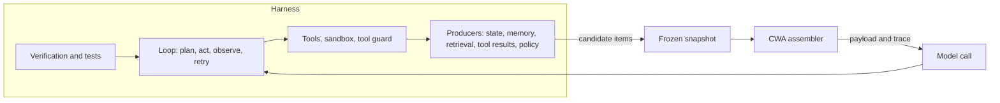
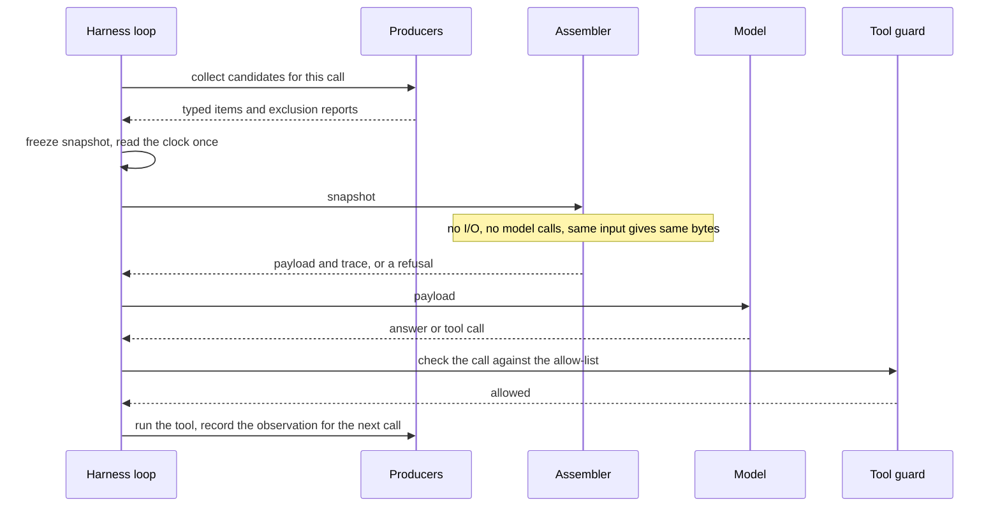
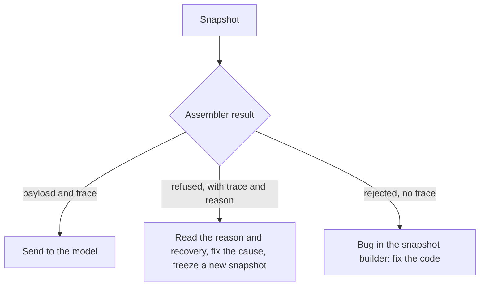
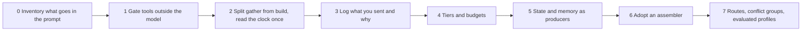

# CWA for harness builders

> Why an agent harness needs Context Window Architecture (CWA), and where it plugs in. It is written for people who build or tune harnesses: the loop, tools, permissions, memory and verification wrapped around a model. It is non-normative: it applies the [producer guide](producers.md) and the [assembler guide](assemblers.md) to the harness and adds no requirement. Rules are cited by their permanent number (R-n) and are normative in [SPEC.md](../SPEC.md). The word "harness" is used loosely in the wild; here it means the software around a model that turns single model calls into an agent. If your system has no loop at all, the idea in The unit is a model call still applies to you.

## Start with the pain

If you have run an agent for more than a week, you have debugged most of these. The left column is what you saw; the middle is what was usually going on; the right is what CWA does about it.

| What you see | What is usually going on | What CWA does |
| --- | --- | --- |
| The agent forgot a rule it was given at the start. | Something trimmed or compacted the prompt to fit, and nothing recorded what it cut. | Slots have tiers. Instructions and the query are never omitted (R-4); protected content is rendered whole or the call is refused (R-16, R-17); everything else sheds in a fixed order, and the trace names each casualty. |
| A web page or tool output gave the agent an order, and it obeyed. | Everything is one stream of text, so imperative wording looks like instruction. | Authority comes from the slot and the authenticated producer, never from wording. Tool output is evidence, not permission to act (R-1, R-7, R-10, R-15). |
| It worked yesterday, and nobody can say what the model saw. | The prompt was built by scattered code that read a live clock, files and caches. | Each call is built from one frozen snapshot. The same snapshot gives the same bytes and hash (R-23), and the trace carries the snapshot's digest (R-21, R-22). |
| It answered confidently from nothing. | A search came back empty, or budget pressure dropped the evidence, and the loop carried on. | A route can require evidence. If too little survives, the assembler refuses with `evidence_required` and says how to recover (R-12). |
| The old answer beat the new one. | An early file read, a stale summary or a remembered fact sits beside current state. | State is written by the application and must be current (R-8). Memory expires and can be revoked (R-9). The route can keep only the newest observation per source (R-25), and declared conflict groups follow route policy (R-11). |
| Our summarizer quietly changed a fact. | A model call sits inside the prompt-building path, so what the agent sees depends on another model's output. | Assembly makes no model calls. Summaries are variants computed beforehand, with a recorded method and lineage, and they may add no fact (R-18). |
| Adding one tool made everything worse, and riskier. | A tool definition is third-party text that renders with governing authority, and the list grows with every integration. | Definitions are proposals. Only the application's capability policy emits them, from a versioned allow-list (R-15), and the tool guard still checks every call (R-5). |
| Cache hits collapsed after a small edit. | Order and wrappers drifted from one call to the next. | Placement is a versioned profile, and any change to it increments the version (R-20). Compacting history in blocks keeps its leading bytes stable ([producers.md](producers.md)). |

The pattern is the same in every row. None of them is a model problem or a tool problem. Each is a decision about the text of one call, made implicitly in the middle of the harness, with no record of it.

That is also why the usual remedies fall short:

- **More prompt does not help.** A rule written into the prompt is a request. CWA's rule zero says to enforce invariants outside the model and keep only guidance in context (R-5).
- **More tests do not help on their own.** Outcome tests tell you the run failed. They do not tell you what the model was shown, or why a piece of evidence was missing.

## The unit is a model call

A model remembers nothing between calls, runs no tools, and holds no state of its own. Everything an agent "knows" at step 12 is the text of call 12. Three things follow:

1. A harness is a loop of model calls with work in between: tools, searches, checks, retries.
2. Loops differ a great deal: a single agent, a planner and an executor, subagents, a workflow graph, a retrieval endpoint. Every call in all of them faces the same question: what text goes in, under whose authority, within what budget, and who can later see why?
3. CWA answers that question for one call and does not care how the loop around it is shaped. Harnesses vary; the contract for a call does not.

This is also why CWA reaches past agents. A classifier step, a nightly extraction job and a retrieval endpoint have no harness, but each builds context for a call. The rest of this guide stays on the harness case, and each call can have its own route, so each agent in a multi-agent design can have its own policy.



## What stays yours and what CWA takes over

CWA replaces exactly one function in your harness: the one that turns everything you know into the request you send. Everything else stays where it is.

| Stays in your harness | Moves to CWA's rules |
| --- | --- |
| The loop, stop conditions and retry limits | Which items are admitted, and why each excluded one was dropped |
| Running tools, the sandbox and the tool guard (R-5) | Who may instruct the model, and who may not (R-1, R-6, R-7) |
| Verification, linters, evals and tests | How a budget is spent and what sheds first (R-16) |
| The state machine that owns task state (R-8) | When to refuse instead of answering from nothing (R-12) |
| Stores for memory and retrieval, and the jobs that compact or summarise | Where each piece sits in the request, and the trace of all of it (R-19, R-20, R-21) |

In CWA's terms, the stores and jobs on the left are producers. They run before the snapshot freezes, and what they hand over is the contract. See [producers.md](producers.md).

## One turn



In code, the shape is small:

```python
while not done:
    items = [producer.collect(task) for producer in producers]  # every read, search and summary happens here
    snapshot = freeze(items, route, profile, budget, now())     # the clock is read once, here
    result = assembler.assemble(snapshot)
    log(result.trace)                                           # keep it with the run
    if result.refused:
        act_on(result.trace)                                    # fix the cause; the next pass freezes a new snapshot
        continue
    reply = model.call(result.payload)
    if reply.tool_call and guard.allows(reply.tool_call, user, route):
        observations.record(run(reply.tool_call))               # becomes evidence for the next call
```

What the harness must get right:

1. **Gather first, then freeze.** Every external read, retrieval, tool call and model call, summarisation included, happens before the freeze. Assembly reads nothing else (R-12, R-18, R-23).
2. **Read the clock once.** `assembly_time` lives in the snapshot, and expiry and freshness are judged against it, never against an ambient clock (R-9, R-23).
3. **One snapshot per model call.** A retry freezes a new one (R-12). In a tool loop each call is its own snapshot.
4. **Authenticate producers yourself.** The route lists each producer under an identity the application bound outside the items. An item's own `source` or `trust` proves nothing (R-15).
5. **Check every tool call at the door.** The model is told what it may call, and the guard enforces it (R-5, R-15).
6. **Hand over exactly what was rendered.** Send each text in the role the renderer assigns, and add no text of your own, or the count and hash in the trace stop describing what the model reads (spec §1).
7. **Keep the trace with the run log.** It is the only record of why the call looked the way it did.

### The three outcomes



A refusal is an outcome of a valid snapshot, not a crash. A harness that never had to say "I cannot build this call" now must handle it. The common refusals and what to do:

| Refusal | What it means for the loop |
| --- | --- |
| `evidence_required` | Read `recovery.action`. `request_context`: nothing was lost to budget, so ask the user or run another tool. `precompute_summary`: an evidence item was shed for size and had no shorter variant, so have its producer compute one. `retrieve_narrower`: its variants were also too big, so retrieve less (R-12). |
| `protected_content_over_budget` | Your instructions, task state or output contract alone do not fit. Shrink them. Retrying will not help (R-17). |
| `required_slot_missing` | A producer failed to deliver instructions, the query, or the output contract on a parser route (R-4). |
| `conflict_unresolved` | A declared conflict has no winner under route policy. Ask for context or escalate, as the route says (R-11). |

A rejection means your snapshot builder produced something that breaks the schemas or a snapshot check, and there is no trace to read (R-17). Treat it as a bug in your code. [assemblers.md](assemblers.md) lists every outcome, including the two where an application's tokenizer or renderer is not accepted.

## Where the things you already have go

| In your harness | CWA slot and authority | Notes |
| --- | --- | --- |
| System prompt, role, safety rules | `governance.instructions`, `governing` | From a policy producer the route lists. Never omitted (R-4). |
| Tool and function definitions | `governance.capabilities`, `governing` | Only the capability policy emits them, from the allow-list (R-15). MCP adapters and local registries propose. |
| Few-shot examples | `governance.examples`, `governing` | Droppable, and they defer to instructions. |
| Required response format | `governance.output_contract`, `governing` | Never omitted when `parser: true` (R-4). |
| Task step, approval status, retry count | `state.task`, `state` | Written by your state machine and never by model output (R-8). |
| User profile and permissions | `state.user`, `state` | Must be current, or it is excluded as `stale_state` (R-8). |
| Search and file-read results the model asked for | `evidence.tool_results`, `observation` | Marked `untrusted_content`. Superseded by source if the route asks (R-25). |
| Retrieved document chunks | `evidence.knowledge`, `reference_only` | One scored item per chunk (R-13). |
| A summary of older turns | `interaction.memory`, `generated` | Needs `expires` and a source turn (R-9). |
| The recent transcript | `interaction.history` | Prior model turns carry `untrusted` and render as a transcript, never as platform messages (R-1, R-7). |
| The user's latest message | `interaction.query`, `user` | Never omitted. The only live user turn. |

Two lines that harness builders often get wrong:

- **A file is not governance because of its name.** A rules file that the model reads through a tool is evidence. One that your operator ships and your application loads through a policy producer the route lists can be governance. The spec draws the line at the authenticated producer, not the filename (R-15).
- **The plan the model wrote is not state.** If your state machine tracks steps and approvals, that is state. The model's own running notes are history or memory, with `generated` or `untrusted` authority, because an assembler must not write state from model output (R-8).

## A worked example: the log that did not fit

A repair agent is on turn 12. Its route requires evidence. The agent ran the test suite, and the observation is long enough that, with the budget for instructions, task state and the output contract already spent, it does not fit. Without CWA, something trims the log, and the next turn the agent argues with a half-sentence. With CWA, the call is refused, and the trace says why:

```json
{
  "trace_id": "repair-turn-12",
  "profile": { "id": "repair-agent", "version": 3 },
  "budget": { "input": 8192, "reserved_output": 1200, "margin_percent": 10 },
  "result": null,
  "included": [],
  "compressed": [],
  "excluded": [
    { "item_id": "obs:call_12", "reason": "over_budget", "stage": "assembler", "slot": "evidence.tool_results" }
  ],
  "conflicts": [],
  "refused": { "bool": true, "reason": "evidence_required" },
  "recovery": { "action": "precompute_summary", "detail": "obs:call_12 has no variants" },
  "context": {
    "spec": "cwa/draft",
    "assembly_time": "2026-10-16T09:30:00Z",
    "route_policy_version": "repair/v2",
    "tokenizer": "estimate-utf8/v1",
    "renderer": "cwa-messages/v1",
    "snapshot_digest": "0f4a1bd2d4a3a17d6a6f59f19a1f0a7c2a2f5e45d9b21d0c0c3d1d9a5c0e6b11"
  },
  "defaults_filled": []
}
```

Read it top to bottom. The only evidence was `obs:call_12`, and it was shed for budget (`over_budget`). Nothing else was left, so the route's evidence requirement refused the call rather than let the model answer from nothing. The recovery is `precompute_summary`, not "search again", because the item had no shorter variant.

The fix is in a producer, not the prompt. The producer that wraps your test runner computes a shorter form before the freeze, such as the failing test names and their assertion lines, and caches it by content hash (R-18):

```json
{
  "items": [
    {
      "id": "obs:call_12",
      "slot": "evidence.tool_results",
      "source": "pytest:tests",
      "source_version": "sha256:5b2e7f0c9a1d4c3e8f6a7b0d1c2e3f405a6b7c8d9e0f1a2b3c4d5e6f708192a3",
      "authority": "observation",
      "trust": "unverified",
      "freshness": "2026-10-16T09:29:40Z",
      "scope": { "tenant": "internal", "task": "t_204" },
      "lineage": "verbatim",
      "injection_risk": "untrusted_content",
      "eligibility": "full output of the run the agent asked for",
      "variants": [
        {
          "id": "obs:call_12#failures",
          "body": "2 failed: test_proration (assert 24.0 == 25.5), test_rounding (KeyError: 'plan')",
          "method": "failing-tests-only",
          "lineage": "extracted"
        }
      ],
      "body": "The full test output would go here; shortened in this example."
    }
  ],
  "excluded": []
}
```

The next snapshot offers the variant, fitting can use it, and the model sees the two failures. The trace records that the variant was used instead of the parent (R-18), so you can tell later that the agent saw the summary, not the whole log.

## Tracing and testing from the harness

The trace turns "why did the agent not see X?" into a lookup. Read `excluded[]`:

| Reason in the trace | Usually means |
| --- | --- |
| `over_budget` | The budget is too tight, or the item has no variants to shrink to. |
| `expired`, `revoked` | Memory aged out or was withdrawn, as intended (R-9). |
| `stale_state` | The state producer is slow or the slot's `max_age_seconds` is too short (R-8). |
| `below_threshold` | The retrieval score fell under the route's `min_relevance` (R-13). |
| `superseded`, `duplicate_content`, `source_diversity_cap` | A route rule you asked for dropped it (R-24, R-25, R-26). Check that you meant to. |
| `conflict_lost`, `conflict_deferred` | A declared conflict was decided by route policy (R-11). |
| `producer_not_authenticated`, `producer_slot_not_allowed` | A wiring bug: the route does not list that producer for that slot (R-15). |
| `untrusted_content_unmarked` | A producer forgot the marker on fetched or user-controlled content (R-10). |
| `out_of_scope` | The item belonged to another tenant, user or task. This is isolation working, because a missing scope key is never a wildcard (R-2). |

Because the same snapshot gives the same bytes, a bad run can be saved as its snapshot and replayed later against a new assembler, profile or route policy. The tests in spec §6.1 are ones a harness's CI can run: golden task, counterfactual ablation, budget pressure, conflict, refusal and cache reuse.

One limit to keep in mind: CWA does not say where things should sit in the request. A profile is a hypothesis about your model and task, and spec §5 asks for it to be evaluated before it is deployed (R-19). The [Evidence page](https://contextwindowarchitecture.io/evidence.html) collects what is known about placement.

## Adopting it in a harness you already have

You can stop at any rung, and each one pays off alone.



0. **Inventory.** List every piece of text that reaches the model and tag it with a slot and an authority. You do not need any code for this, and the surprises you find are the point: an instruction that arrives through a tool result, state inferred from conversation, a summary with no expiry.
1. **Gate tools outside the model (R-5).** If a rule matters, enforce it in code.
2. **Split gathering from building.** Everything that does I/O comes first, and the build step becomes a function of what was gathered and one clock reading.
3. **Log what you send and why.** Even a hand-rolled version of the trace's `included` and `excluded` lists answers most debugging questions.
4. **Give pieces tiers and budgets.** Decide what must never be cut, what can shrink, and what goes first.
5. **Move state and memory into producers.** State is written by the application. Memory carries an expiry and a source turn (R-8, R-9).
6. **Adopt an assembler.** There are four, in Python, TypeScript, Go and Rust, each built from the published contract. The specification is a draft and none is released, so read each one's conformance report in [implementations/](../implementations) before relying on it.
7. **Declare routes, conflict groups and profiles, and evaluate the profiles.**

## Where it costs you, and what it does not do

Be honest about the costs before adopting it.

- **Typing every item is work.** Eight fields are required on every item, and six more carry policy (spec §2.2). The slot defaults fill the policy fields, but you still write the eight.
- **Strictness means refusals.** The loop must handle a call that cannot be built.
- **Summaries must run ahead of need.** Variants are computed before the freeze, so a harness that compacts "on demand, inside the prompt" has to restructure.
- **Long loops pay per step.** Each model call is a new snapshot, so gather and admission happen at every step.
- **Producer and application conformance rests on their word.** The assembler's decisions are checked by evidence; the claim that a producer reported everything it suppressed, or that the application enforces its invariants, is an agreement (spec §1).
- **It is a draft.** The specification is not stable, and the assemblers are not released.

And what it does not do:

- It does not run your loop, sandbox your tools, or verify the model's output. That is the rest of the harness.
- It does not choose the best placement for your model. Profiles must be evaluated (R-19).
- It does not find contradictions in prose. The application declares conflict groups, and the assembler never infers them (R-11).
- It does not make answers smarter. Its claim is control and auditability of the call, and spec §6 puts outcome metrics on top of that.

You may not need it for a single-purpose tool with one user, no untrusted text and nothing to audit. The first row of the pain table is usually where a harness stops being that.

## Open questions

The mapping above rests on choices the specification leaves open. Each is a candidate for a later revision.

1. **A producer kind for a harness's own tools.** The route policy names seven kinds: `policy`, `state`, `retrieval`, `memory`, `mcp`, `capability_policy` and `interaction`. None is a local tool runner. The `interaction` and `policy` kinds carry no slot rule of their own, and `retrieval` and `mcp` may send to `evidence.tool_results`, so several routes work, but the specification does not say which is right for a shell or file-read tool.
2. **Subagents.** A parent's call sees a child's result most naturally as an observation in `evidence.tool_results`, and the child's own calls would use their own route and snapshots. The specification does not say so.
3. **The model's scratch notes and plans.** History, memory and evidence each fit part of the case, and none says what a harness should do with a file the model wrote and reads back.
4. **Per-step cost.** A way to reuse the admitted parts of one snapshot in the next, without weakening determinism, is not specified.
5. **Non-text content.** An item's body is text. [mcp.md](mcp.md) lists the same gap for images and audio.
6. **When to compact.** Overflow is summarised into memory before assembly (spec §2.1), and block compaction helps caches, but the cadence is the harness's call.
7. **Producer fixtures.** The conformance cases test assemblers. Nothing yet tests that a harness's producers emit what they should (see [mcp.md](mcp.md), Open questions).

## Sources

- Requirements: [SPEC.md](../SPEC.md)
- Producers: [producers.md](producers.md)
- Assemblers and outcomes: [assemblers.md](assemblers.md)
- MCP adapters: [mcp.md](mcp.md)
- Trace schema: [schema/trace.schema.json](../schema/trace.schema.json)
- Item schema: [schema/context_item.schema.json](../schema/context_item.schema.json)
- Route-policy schema: [schema/route_policy.schema.json](../schema/route_policy.schema.json)
- Placement and caching evidence: https://contextwindowarchitecture.io/evidence.html
- On the word "harness", whose definitions differ: https://arxiv.org/pdf/2605.13357 and https://arxiv.org/pdf/2609.00006
